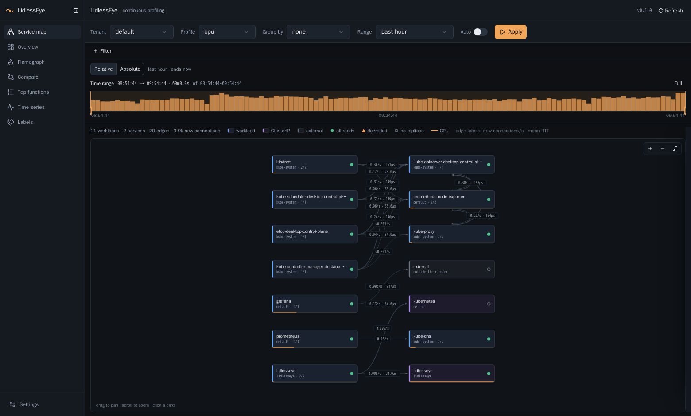
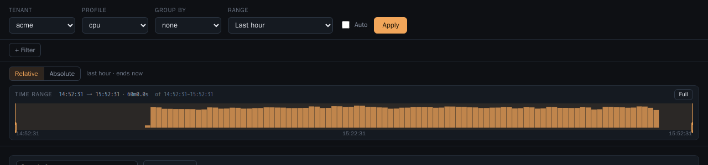
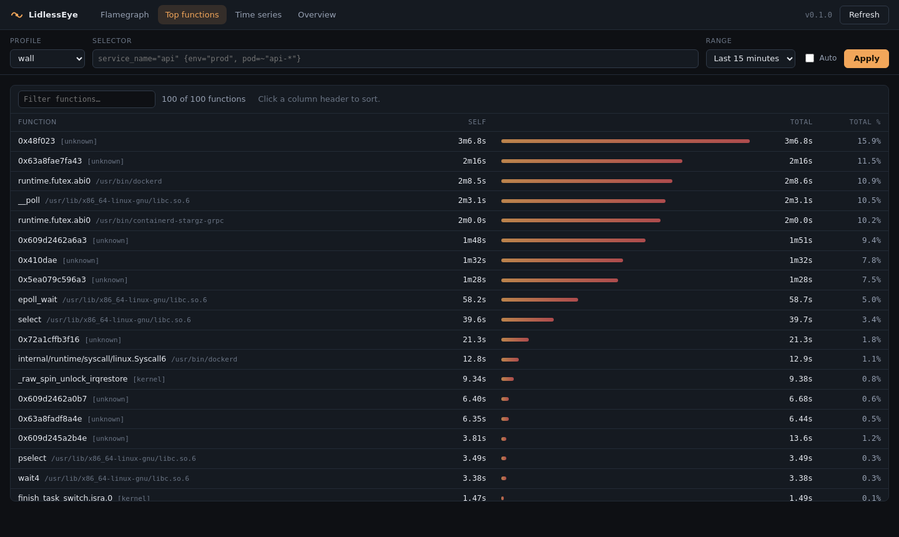

<div align="center">


**Continuous profiling for Linux — one Rust binary, eBPF collection, DuckDB storage, and a dashboard that opens on your service map.**

[](https://github.com/xsj321/LidlessEye/actions/workflows/ci.yml)
[](https://github.com/xsj321/LidlessEye/releases)
[](https://crates.io/crates/lidlesseye)
[](LICENSE)
[](crates)
[](crates/lidlesseye-core)

[English](README.md) · [中文](README.zh-CN.md) · [Step-by-step usage](docs/USAGE.md) · [使用指南（中文）](docs/USAGE.zh-CN.md) · [Changelog](CHANGELOG.md)

</div>

---

## Start here

```bash
make release                                     # exports the dashboard, then builds Rust
sudo ./target/release/lidlesseye serve --agent --data-dir ./data
# open http://localhost:4040
```

No Linux box handy? `./scripts/demo.sh` seeds a realistic demo in Docker and prints the URL. Nothing is installed on the host.

Already have a toolchain? The same server is on crates.io: `cargo install lidlesseye`. It links DuckDB dynamically, so `libduckdb.so` must be on the loader path — which is why the container image is the zero-dependency route.

To use it as a library instead, `cargo add lidlesseye` and start from the [embedding guide](docs/embedding.md).

The dashboard opens on the **service map**. Click any node to inspect its SLO, replicas, CPU, memory, network, DNS and a flamegraph scoped to that workload — without leaving the topology.



## Why LidlessEye

| Choice | Instead of | Why |
| --- | --- | --- |
| DuckDB 2.0 as the storage engine | a hand-written columnar format, an LSM or a TSDB | profiles are append-only rows filtered by time and grouped by stack; DuckDB already does that, plus compression, transactions and recovery, so only the schema is ours |
| One Rust workspace, with the server usable as a crate | a Go binary you deploy | "profile this process and show me the flamegraph" becomes one `builder().build()` call |
| Symbolization in the agent | symbolization in the server | the server never needs the profiled machine's filesystem, and short-lived processes stay readable |

```
 processes        agent                       server
┌──────────┐  ┌────────────────┐  ┌──────────────────────────┐
│ any lang │─►│ eBPF sampling  │─►│ POST /ingest → DuckDB    │
│          │  │ blazesym       │  │ query API + embedded UI  │
└──────────┘  └────────────────┘  └────────────┬─────────────┘
                                               │ HTTP
                                      ┌────────▼─────────┐
                                      │ service map → UI │
                                      └──────────────────┘
```

## What you get

**Collection** — on-CPU (`PERF_COUNT_SW_CPU_CLOCK`), off-CPU (`schedule` kprobes), and the virtual `wall` profile that merges both. Aggregation happens in the kernel, so overhead does not grow with the sampling rate. Any process, any language: no SDK, no `LD_PRELOAD`, no recompilation.

**Memory** — two readers, because heaps are not one thing. Go processes are read from the runtime's own profile chain (`runtime.mbuckets`), so the numbers are the runtime's, at its own sampling rate. Everything else — C, C++, Rust, jemalloc, mimalloc, tcmalloc, musl — is counted at the allocator's entry points by uprobes on `malloc`/`calloc`/`realloc`/`free`, which covers every language that mallocs. Both report `alloc_space`/`alloc_objects` (allocated per interval, a rate) and `inuse_space`/`inuse_objects` (held live, a level), told apart by `profile_source` and `runtime` labels so the two are never added together.

**Explore** — the service map is built from each node's TCP tables and Kubernetes pod metadata. Edges carry live **connections/s** and **mean RTT**. A click opens a sliding, non-modal inspector with one hop of neighbours and seven tabs:

| Tab | Answers |
| --- | --- |
| SLO | availability against a 99.9% objective, error-rate trend, mean RTT |
| Instances | desired/ready replicas over time and the pod list with their nodes |
| CPU | cores over the window from on-CPU samples |
| Memory | the heap profile type the agent actually sent — `inuse_space` by preference, then `alloc_space` — with unit-aware formatting and level-vs-rate wording |
| Net | throughput in/out, round-trip time, callers and callees |
| DNS | TCP/53 peers, latency and retransmits |
| Profiling | hottest functions, **an embedded flamegraph for this node**, and a jump to the full view |

**Analyse** — flamegraphs with search, zoom and breadcrumbs; top-N functions; time series; a label explorer with structured filter rows; and a comparison view that colours a regression red. Windows are chosen the way a Grafana user expects: pick a range first, then bracket the part of it you care about.

**Operate** — multi-tenancy via `X-Scope-OrgID`, per-tenant tokens and retention, Prometheus metrics, a `fsck` command, a Docker image, a Helm chart and an embeddable Rust API.

 

## Performance

Measured on a single server replica against a synthetic 30-day e-commerce cluster: 64 services, 244 edges, 687,792 profile reports (~41M stack samples), stacks up to 1,022 frames, 490 MB on disk. No pre-aggregation and no external index: every number below scans the Parquet the ingest path wrote.

| Query (one-hour window) | p50 | p95 |
| --- | ---: | ---: |
| Stats | 37 ms | 41 ms |
| Service map | 41 ms | 46 ms |
| Map histogram | 11 ms | 33 ms |
| Time series | 33 ms | 35 ms |
| Top functions | 135 ms | 193 ms |
| Flamegraph | 178 ms | 212 ms |

A wider flamegraph grows with the data rather than falling off a cliff:

| Window | p50 | p95 |
| --- | ---: | ---: |
| 1 hour | 167 ms | 192 ms |
| 6 hours | 689 ms | 752 ms |
| 24 hours | 2.8 s | 3.0 s |
| 7 days | 6.2 s | 7.4 s |
| 30 days | 7.8 s | 9.2 s |

The 30-day row is the full 41M-row scan behind "show me the whole month"; normal dashboard use stays in the tens to low hundreds of milliseconds.

**Concurrent dashboards.** 16 clients polling stats, map, histogram and series for 15 seconds: **34 req/s**, p50 356 ms, p95 894 ms, p99 999 ms, zero errors on one replica. The server keeps one DuckDB connection and serialises queries, so this is the queue a real dashboard sees rather than a synthetic parallel scan.

**What it costs.** During the run Prometheus measured **1.35 GB average / 1.97 GB peak RSS** and **1.96 / 3.39 cores average/peak** on a 20-vCPU node. The 30 days occupy **490 MB** on disk.

Reproduce it: generate the dataset with `node scripts/seed-ecommerce.mjs --profile stress`, then run `node scripts/bench.mjs --base http://127.0.0.1:4040 --tenant shop-stress`. The script prints the same tables and can write JSON/Markdown for a release note.

## Dashboard tour

The left drawer switches between Service map, Overview, Flamegraph, Compare, Top functions, Time series and Labels. It collapses to icons with a single click; the choice is remembered in this browser. The header bar holds the tenant selector (left of the version) and Refresh; the profile toolbar is hidden on the service map, where the relative range is picked beside the histogram. The histogram above the map counts requests (new connections), not CPU samples. **Settings** sits at the bottom of the drawer and controls the interface language (English / 简体中文), start-up view, default range, refresh interval, map edge labels and their zoom threshold, flamegraph frame cap and histogram resolution.

Every view reads the same window and filters from the URL. Copy the address bar to share exactly what you are seeing. See [the step-by-step guide](docs/USAGE.md) for the full walkthrough.

## Quick start

### One binary, one host

```bash
make release
sudo ./target/release/lidlesseye serve --agent --data-dir ./data
```

Prerequisites: Linux ≥ 5.5 with BTF (`/sys/kernel/btf/vmlinux`), `clang`, root (or `CAP_BPF` + `CAP_PERFMON` + `CAP_SYS_ADMIN`), and Node 20.19+ for the dashboard export. `perf_event_paranoid` must be ≤ 2. The first build downloads a prebuilt `libduckdb.so`; for offline builds set `DUCKDB_LIB_DIR` to a directory holding a copy. When running from the build tree set `LD_LIBRARY_PATH` to the `target/release/build/libduckdb-sys-*/out` directory.

```bash
./scripts/demo.sh                # no root, no eBPF — just Docker
./scripts/demo.sh --stop

# or the published image, which is built from deploy/docker/Dockerfile and
# mirrored to ghcr.io/xsj321/lidlesseye under the same digest
docker run --rm -p 4040:4040 -v lidlesseye-data:/var/lib/lidlesseye \
  docker.io/xsj321/lidlesseye:0.1.2
```

### Server and agents

```bash
# storage box
lidlesseye serve --data-dir /var/lib/lidlesseye --listen 0.0.0.0:4040 --retention 7d

# every node
sudo lidlesseye collect --server http://storage:4040 --frequency 99
```

In Kubernetes the Helm chart renders a server `Deployment` and a privileged agent `DaemonSet` that lists pods on its node so profiles are named after workloads:

```bash
helm install lidlesseye deploy/helm/lidlesseye \
  --namespace observability --create-namespace \
  --set server.persistence.size=100Gi \
  --set server.auth.enabled=true
```

Storage defaults to one DuckDB file per tenant. For large or long-lived
datasets, `--set server.storage.mode=parquet` switches the server to tiered
Parquet objects in S3 (memory hot tier → local Parquet → hourly S3 archive,
read back through zero-copy DuckDB scans); credentials and endpoint are set
under `server.storage.s3`. Both modes and the full option list are documented
in [deployment.md](docs/deployment.md).

## Embed it

```toml
[dependencies]
lidlesseye = "0.1"
```

```rust
use lidlesseye::{LidlessEye, Result};

#[tokio::main]
async fn main() -> Result<()> {
    let eye = LidlessEye::builder()
        .data_dir("./profiles")
        .listen("127.0.0.1:4040")
        .agent(true)
        .service_name("my-service")
        .frequency_hz(99)
        .build()
        .await?;
    eye.run().await
}
```

`agent(false)` gives you storage and the HTTP API only. Runnable examples: `cargo run --example embed`, `cargo run --example synthetic`.

## HTTP API

| Method | Path | Description |
| --- | --- | --- |
| `POST` | `/ingest` | one report or `{"reports": [...]}` |
| `GET` | `/api/v1/flamegraph` | nested or flat frame tree |
| `GET` | `/api/v1/top` | top functions by self value |
| `GET` | `/api/v1/timeseries` · `/api/v1/series` | bucketed series |
| `GET` | `/api/v1/label-names` · `/api/v1/label/{name}/values` | label exploration |
| `GET` | `/api/v1/diff` | two windows in one tree |
| `GET` | `/api/v1/profile_types` | profile types present, including `wall` |
| `GET` | `/api/v1/servicemap` · `/api/v1/servicemap/history` | topology and per-node history |
| `GET` | `/api/v1/tenants` · `/api/v1/health` · `/stats` · `/version` | operations |
| `GET` | `/metrics` | Prometheus text format |

Common parameters: `profile_type`, `from`, `until` (unix seconds, `1700000000ms`, RFC3339, `now-1h`), `selector`, `group_by`, `max_nodes`, `limit`, `step`, `buckets`. Requests are tenant-scoped by `X-Scope-OrgID`; without it the `default` tenant is used.

```bash
curl -s 'http://localhost:4040/api/v1/top?profile_type=cpu&from=now-1h&limit=5' | jq
curl -s 'http://localhost:4040/api/v1/servicemap?from=now-1h' | jq '.nodes | length'
```

## CLI

```
lidlesseye serve    # HTTP server, optionally with --agent
lidlesseye collect  # eBPF collector pushing to a server
lidlesseye ingest   # import JSON / pprof / folded reports
lidlesseye query    # inspect a data directory
lidlesseye fsck     # verify database integrity
lidlesseye info     # build and platform information
```

`collect` accepts `--frequency`, `--flush`, `--label k=v`, `--service-name`, `--no-cpu`, `--no-offcpu`, `--no-heap`, `--no-alloc`, `--heap-objects`, `--no-k8s-labels`, `--no-k8s-pod-metadata`, `--k8s-pod-refresh`, `--server`, `--tenant`, `--auth-token` and `--duration`. Set `LIDLESSEYE_NODE_NAME` (the Helm chart passes `spec.nodeName`) so the `node` label stays stable across rollouts.

Full reference: [HTTP API](docs/api.md) · [Architecture](docs/architecture.md) · [Deployment](docs/deployment.md) · [UI](docs/ui.md).

## Testing

```bash
cargo test --workspace
cargo clippy --workspace --all-targets -- -D warnings
cargo fmt --all --check
./scripts/ui-smoke.sh          # Chromium: every view, drawer, settings and deep links
./scripts/deploy-smoke.sh      # shipped image: ingest, query, tenant isolation
```

The browser test seeds two tenants and fails on any console error, so a rendering regression cannot pass as "the API is fine".

## Limits

- **Linux only** for collection. Storage and query APIs are portable Rust.
- **Symbolized at ingest**: modules that cannot be opened become `[unknown]` frames; agents need `hostPID` and read access to the binaries.
- **One PID namespace per agent**: processes in other containers are counted as `in another PID namespace`, never misattributed.
- **Per-host storage**: one server per volume; no clustering or replication.
- **uprobes are opt-in and narrow**: TLS plaintext capture stays behind `LIDLESSEYE_SSL_UPROBE=1`. Allocation profiling is on by default (`--no-alloc` disables it) and instruments one file per allocator per container — glibc, musl, jemalloc, mimalloc or tcmalloc, whichever the process maps.
- **User stacks need frame pointers** (`-C force-frame-pointers=yes` / `-fno-omit-frame-pointer`). The profiled time is still correct without them.

## Documentation

| Document | What it answers |
| --- | --- |
| [Step-by-step usage](docs/USAGE.md) · [中文](docs/USAGE.zh-CN.md) | the dashboard, ranges, filters, the CLI, first hour with the tool |
| [Architecture](docs/architecture.md) | how eBPF collection, ingest, DuckDB and the service map fit together, and why |
| [HTTP API](docs/api.md) | every endpoint, parameter and response shape |
| [Deployment](docs/deployment.md) | Helm values, storage modes, S3 archiving, retention, quotas |
| [Dashboard and UI rules](docs/ui.md) | what each view shows, and the design rules the front end is held to |
| [Embedding](docs/embedding.md) | using the server as a Rust crate |
| [Multi-tenancy](docs/multi-tenancy.md) | tokens, `X-Scope-OrgID`, isolation guarantees |
| [Compatibility](docs/compatibility.md) | kernels, distributions, Kubernetes versions |
| [Changelog](CHANGELOG.md) | what changed in each release |

## Contributing

Issues and pull requests are welcome. [CONTRIBUTING.md](CONTRIBUTING.md) lists the
gates a change has to pass and the design rules the dashboard is held to;
[SECURITY.md](SECURITY.md) explains how to report a vulnerability privately.
Releases are tag-driven — `git tag v0.1.2 && git push origin v0.1.2` — and the
workflow in `.github/workflows/release.yml` publishes the notes and the chart.

## License

Apache-2.0 throughout, **except** `crates/lidlesseye-ebpf/bpf/profile.bpf.c`, which is GPL-2.0-only because the kernel refuses to load a BPF program that calls GPL-only helpers otherwise. See [LICENSE](LICENSE), [LICENSE-BPF](LICENSE-BPF) and [NOTICE](NOTICE).
