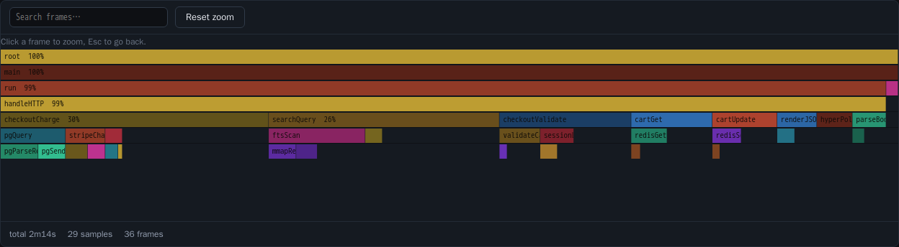
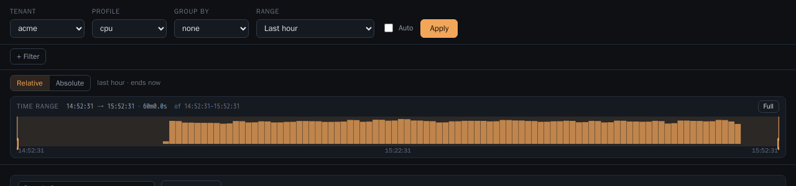
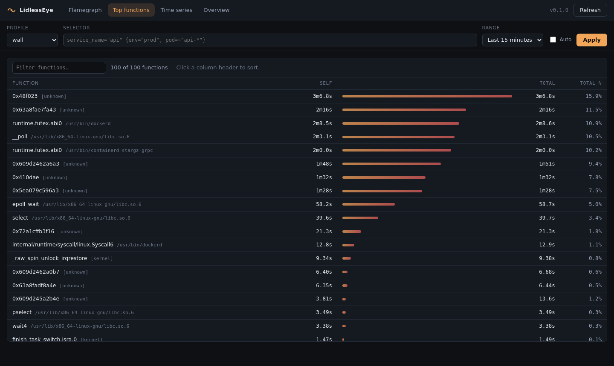

# LidlessEye

**Continuous profiling for Linux, in one Rust binary.**

LidlessEye samples every process on a machine with eBPF, symbolizes the stacks
in the agent, stores them in DuckDB and serves flamegraphs from an embedded
dashboard. It is a Pyroscope-shaped product built around three deliberate
choices:

| Choice | Instead of | Why |
| --- | --- | --- |
| DuckDB 2.0 as the storage engine | a hand-written columnar format, an LSM or a TSDB | profiles are append-only rows filtered by time and grouped by stack; DuckDB already does that, plus compression, transactions and recovery, so this project keeps only the schema |
| A single Rust workspace, with the server usable as a `cargo` crate | a Go binary you deploy | "profile this process and show me the flamegraph" becomes one `builder().build()` call |
| Symbolization in the agent | symbolization in the server | the server never needs the profiled machine's filesystem, and profiles of short-lived processes stay readable |

```
┌─────────────┐   eBPF samples   ┌──────────────┐  profile batches ┌──────────────┐
│  processes  │ ───────────────► │    agent     │ ───────────────► │    server    │
│  (any lang) │  perf_event +    │  symbolize   │   POST /ingest   │  store+query │
└─────────────┘  kprobes         │  (blazesym)  │                  │  + web UI    │
                                 └──────────────┘                  └──────┬───────┘
                                                                          │ HTTP
                                                                   ┌──────▼───────┐
                                                                   │  dashboard   │
                                                                   └──────────────┘
```

## Screenshots



The window is picked in two steps: choose a range first — a relative preset or
an absolute `From → To` with date-time pickers — and the histogram spans exactly
that range. The bracket then slides inside it: drag to select, drag its edges to
resize, or click to jump. Label filters are structured rows above it, and the
comparison view gets two of these brackets. Every control is described in
[docs/ui.md](docs/ui.md).





## What it does

**Profiles**

- **On-CPU** — one software perf event per CPU (`PERF_COUNT_SW_CPU_CLOCK`) fires
  `frequency` times per second and captures the user *and* kernel stack.
- **Off-CPU** — `kprobe:schedule` / `kprobe:finish_task_switch` measure how long
  each task was blocked and where it was blocked.
- **`wall`** — a virtual profile type: `cpu` merged with `off_cpu`, so you can
  see "this request spent 4% on CPU and 96% waiting".
- Aggregation happens **in the kernel** (`BPF_MAP_TYPE_HASH` keyed by
  `(tgid, user_stack, kernel_stack)`); user space only drains maps once per
  flush interval, so overhead does not grow with the sampling rate.
- Any process, any language: no SDK, no `LD_PRELOAD`, no recompilation. Kernel
  threads and `[unknown]` frames are first-class citizens.

**Stores and queries**

- Flamegraphs (nested, with self/inclusive values), top-N functions by self or
  total value, and time series bucketed by service and label set.
- A **comparison view** (`/api/v1/diff`): two windows in one tree, so a
  regression shows up as a red frame instead of a number you have to eyeball.
- `group_by` any label — pod, container, service — as flamegraph frames or as
  separate time series.
- Labels and PromQL-flavoured selectors: `service_name="api" {env="prod",
  pod=~"api-*"}`, a label explorer, and `label-names` / `label/{name}/values`.
- The dashboard picks windows like Grafana does: choose a relative or absolute
  range (with date-time pickers), then bracket the window you want to analyse
  inside it — plus a second, independent bracket in the comparison view. Label
  filters are structured rows, not a selector string you have to type from
  memory.
- Ingest speaks **pprof protobuf** and **folded/collapsed text** as well as its
  own JSON, so the Pyroscope SDKs and `go tool pprof` output push directly.
- **Multi-tenancy**: `X-Scope-OrgID`, per-tenant tokens, per-tenant retention,
  disk budget and series cap.
- Retention by age and by disk budget, plus `lidlesseye fsck` to verify the
  database's integrity and the references between its tables.

**Ships as**

- one binary (`lidlesseye serve --agent`) — no agent needed for a single host,
- a Docker image and a `docker-compose.yml`,
- a Helm chart with a server `Deployment` and a per-node agent `DaemonSet`,
- a Rust crate you can `use lidlesseye::LidlessEye` inside your own service.

## Quick start

### One binary, one host

```bash
cargo build --release            # needs clang for eBPF; DuckDB's library is fetched once
sudo ./target/release/lidlesseye serve --agent --data-dir ./data
# dashboard on http://localhost:4040
```

Prerequisites: Linux ≥ 5.5 with BTF (`/sys/kernel/btf/vmlinux`, used to
resolve the collector's CO-RE relocations), `clang`, and root (or `CAP_BPF` +
`CAP_PERFMON` + `CAP_SYS_ADMIN`). The first build downloads the prebuilt
`libduckdb.so` matching `duckdb = "1.20000.1"`, so it needs network access once;
set `DUCKDB_LIB_DIR` to a directory holding a vendored copy for offline builds.
The binary loads that shared library at runtime: set `LD_LIBRARY_PATH` to the
`target/release/build/libduckdb-sys-*/out` directory when running from the
build tree, and ship `libduckdb.so` alongside the binary (or install it under
`/usr/local/lib` and run `ldconfig`) when copying it to another host. The
Docker image does this for you. `perf_event_paranoid` must be ≤ 2 for the
perf-event sampler.
On a system with `kernel.unprivileged_bpf_disabled` the agent still works as
root.

### Look at the dashboard without profiling anything

```bash
./scripts/demo.sh                # build, run, seed two tenants, print the URL
```

The demo seeds three services over 45 one-minute windows with `cpu` and
`off_cpu` profiles, so every tab has something real to draw. It runs detached
on `127.0.0.1:4040` with a throwaway data directory; `./scripts/demo.sh --stop`
removes the container. Requires Docker only — no root, no eBPF, no local Rust.

### Server + agents

```bash
# on the storage box
lidlesseye serve --data-dir /var/lib/lidlesseye --listen 0.0.0.0:4040 --retention 7d

# on every node
sudo lidlesseye collect --server http://storage:4040 --frequency 99
```

### Docker

```bash
docker compose up --build
open http://localhost:4040
```

The agent container runs `privileged` with `pid: host`, which is what eBPF
profiling needs; the server container runs unprivileged.

### Kubernetes

```bash
helm install lidlesseye deploy/helm/lidlesseye \
  --namespace observability --create-namespace \
  --set server.persistence.size=100Gi \
  --set server.auth.enabled=true
```

The chart renders a server `Deployment` (PVC, health probes, optional
`ServiceMonitor`) and an agent `DaemonSet` with `hostPID: true`,
`privileged: true` and `tolerations: [{operator: Exists}]` so it covers tainted
nodes too. The agent lists the pods on its node (the chart creates the
`pod-reader` ClusterRole for that), so a series is named after the Deployment or
StatefulSet that produced it rather than after the binary inside it. See
[docs/deployment.md](docs/deployment.md).

## Embed it in your own binary

```toml
[dependencies]
lidlesseye = "0.1"
```

```rust
use lidlesseye::{LidlessEye, Result};

#[tokio::main]
async fn main() -> Result<()> {
    let eye = LidlessEye::builder()
        .data_dir("./profiles")
        .listen("127.0.0.1:4040")
        .agent(true)              // profile this machine
        .service_name("my-service")
        .frequency_hz(99)
        .build()
        .await?;

    println!("dashboard: {}/", eye.base_url());
    eye.run().await
}
```

`agent(false)` gives you storage plus the HTTP API only — feed it with
`eye.ingest(report)` or `POST /ingest`. Runnable examples:

```bash
cargo run --example embed        # embedded server (+ `-- agent` for eBPF)
cargo run --example synthetic    # build profiles by hand, query them back
```

More in [docs/embedding.md](docs/embedding.md).

## HTTP API

| Method | Path | Description |
| --- | --- | --- |
| `POST` | `/ingest` | one report or `{"reports": [...]}` |
| `GET` | `/api/v1/flamegraph` | flat `names`/`levels`/`values` triples, or `?format=tree` |
| `GET` | `/api/v1/top` | top functions by self value, with self and total columns |
| `GET` | `/api/v1/timeseries` | stacked buckets per series |
| `GET` | `/api/v1/series` | known series in a range |
| `GET` | `/api/v1/label/{name}/values` | label values, with totals |
| `GET` | `/api/v1/profile_types` | profile types present (including virtual `wall`) |
| `GET` | `/api/v1/diff` | two windows compared in one tree |
| `GET` | `/api/v1/label-names` · `/api/v1/labels` | label keys seen in a range |
| `GET` | `/api/v1/tenants` | tenants with their size and limits |
| `GET` | `/api/v1/health` · `/ready` · `/stats` · `/version` | operations |
| `GET` | `/metrics` | Prometheus text format |

Common query parameters: `profile_type` (aliases `type`), `from` / `until`
(unix seconds, `1700000000ms`, RFC3339, `now-1h`), `selector`, `group_by`,
`max_nodes`, `limit`, `step`, `buckets`.

Every request belongs to one tenant, named by `X-Scope-OrgID` (the header
Pyroscope and the Grafana datasource send). Without it, and without auth, the
`default` tenant is used.

```bash
# how much CPU did the checkout service burn in the last hour?
curl -s 'http://localhost:4040/api/v1/top?profile_type=cpu&from=now-1h&limit=5' | jq

# who is blocking, and on what?
curl -s 'http://localhost:4040/api/v1/flamegraph?profile_type=off_cpu&from=now-15m' \
  | jq '.names, .total'

# what got slower than the hour before?
curl -s 'http://localhost:4040/api/v1/diff?from=now-1h&baseline_from=now-2h' \
  | jq '[.names, .diff] | transpose | sort_by(.[1]) | .[-5:]'

# one tenant's data, grouped by pod
curl -s -H 'X-Scope-OrgID: acme' \
  'http://localhost:4040/api/v1/flamegraph?from=now-1h&group_by=pod' | jq .total
```

Full reference: [docs/api.md](docs/api.md).

## CLI

```
lidlesseye serve    # HTTP server, optionally with --agent
lidlesseye collect  # eBPF collector that pushes to a server
lidlesseye ingest   # import report JSON from files or stdin
lidlesseye query    # inspect a data directory: --top / --tree
lidlesseye fsck     # verify database integrity and cross-table references
lidlesseye info     # build and platform information
```

`serve` takes the storage flags (`--retention`, `--max-disk`,
`--duckdb-threads`) and `--agent` to start the collector in-process; with
`--agent` it also accepts the collector flags below.

`collect` accepts `--frequency`, `--flush`, `--label k=v`, `--service-name`,
`--no-cpu`, `--no-offcpu`, `--no-k8s-labels` (drop the `k8s_*` labels derived
from each cgroup), `--no-k8s-pod-metadata` and `--k8s-pod-refresh` (name series
after the pod's workload by listing pods on the node), plus `--server <url>`,
`--tenant`, `--tenant-header`
(default `X-Tenant-Id`, the alias the server always accepts), `--auth-token`
and `--duration` (stop after this long; used by the tests).

`ingest` accepts `--format json|pprof|folded` and `--tenant`; `query` accepts
`--tenant`, `--group-by`, `--top` / `--tree`.

Collector placement: the `node` label defaults to the machine hostname, but in a
pod that is the pod name and changes on every rollout. Set `LIDLESSEYE_NODE_NAME`
(the Helm chart passes `spec.nodeName`) so the label stays stable.

Multi-tenancy flags on `serve`:

```
--tenant-header X-Scope-OrgID          # the header carrying the tenant id
--tenant-token <token>=<tenant>        # repeatable; binds a token to a tenant
--allowed-tenant acme                  # repeatable; refuse anything else
--tenant-limit acme:max_series=50000   # retention / max_disk / max_series
--max-tenants 1000                     # cap on tenants
--tenant acme                          # where the built-in agent writes
```

Most flags also read environment variables (`LIDLESSEYE_DATA_DIR`,
`LIDLESSEYE_LISTEN`, `LIDLESSEYE_SERVER`, `LIDLESSEYE_AUTH_TOKEN`,
`LIDLESSEYE_TENANT_TOKENS`), which is what the Helm chart uses to keep tokens
out of the pod spec.

## How it works

- [Dashboard](docs/ui.md) — every control, the histogram brush gestures, deep
  links and the URL model, and how the front end is built.
- [Architecture and storage](docs/architecture.md) — the DuckDB schema, why it
  replaced a hand-written format, sampling model, query pipeline, concurrency.
- [HTTP API](docs/api.md) — every endpoint, parameter and payload.
- [Deployment](docs/deployment.md) — single host, Docker, Kubernetes,
  privileges, storage sizing, monitoring, troubleshooting.
- [Embedding](docs/embedding.md) — the crate API, custom collectors, direct
  ingestion.
- [Multi-tenancy](docs/multi-tenancy.md) — layout, tenant resolution, tokens,
  limits, failure modes.
- [Pyroscope compatibility](docs/compatibility.md) — what matches, what differs,
  and what is deliberately out of scope.

All documents, with the audience for each: [docs/](docs/README.md).

Repository layout:

```
crates/lidlesseye-core    data model, DuckDB store, query engine, selectors
crates/lidlesseye-ebpf    aya programs (BPF C), collector, blazesym symbolization
crates/lidlesseye-server  axum HTTP API, embedded UI, metrics
crates/lidlesseye         the `LidlessEye` builder, the CLI, the publisher
web/                      the dashboard (Next.js + shadcn, static export into dist)
deploy/                   Dockerfile, docker-compose, Helm chart
```

## Testing

```bash
cargo test --workspace        # unit, integration and end-to-end tests

# eBPF against a real kernel (root; Docker is enough)
DEV_PRIVILEGED=1 DEV_ENV="RUSTFLAGS=-C force-frame-pointers=yes" \
    ./scripts/dev.sh cargo test -p lidlesseye-ebpf --test ebpf_e2e \
    -- --ignored --nocapture

# how many frames get a name (root; samples the whole machine)
DEV_PRIVILEGED=1 ./scripts/dev.sh cargo test -p lidlesseye-ebpf \
    --test symbol_coverage -- --ignored --nocapture

# the dashboard in Chromium (Docker only)
./scripts/ui-smoke.sh

# the shipped image: build, run, ingest, query, tenant isolation
./scripts/deploy-smoke.sh
```

The browser test seeds two tenants, walks every tab and fails on a console
error, so a rendering regression cannot pass as "the API is fine". The coverage
test fails if more than a quarter of the sampled frames come back as bare
addresses, so losing the inline expansion or the Go symbol table is a build
failure rather than a slightly worse-looking flamegraph.

## Limits

- **Linux only** for collection. The storage server and the query API are
  portable Rust and run anywhere (the tests run on every platform).
- **Symbolized at ingest**: a profile whose modules cannot be opened becomes a
  tree of `[unknown]`/`0x…` frames. Agents therefore need `hostPID` (or
  `--pid=host`) plus read access to the binaries that are running. Addresses
  that stay unnamed are counted by cause, and `lidlesseye collect` prints the
  breakdown (`missing_syms` means "install debug info", `missing_component`
  means "JIT without a perf map").
- **One PID namespace per agent**: `bpf_get_ns_current_pid_tgid` only answers
  for tasks that share the agent's namespace, so processes in *other*
  containers cannot be attributed. Those samples are counted as
  `in another PID namespace` rather than silently misattributed.
- **Per-host storage**: the server is a single writer over a local directory.
  Run one server per storage volume; there is no clustering or replication.
- **No dynamic tracing yet**: only the built-in CPU/off-CPU profilers. Uprobes,
  allocations and lock contention are the obvious next steps.
- **User stacks need frame pointers.** The kernel unwinder walks the stack
  through them, so a target built without frame pointers shows the leaf
  function but not its callers. The profiled time is still correct. Build Rust
  targets with `-C force-frame-pointers=yes` and C/C++ with
  `-fno-omit-frame-pointer`; precompiled `std` in the toolchain is the one part
  that cannot be fixed that way. Measured effect: 94 % of a spinning thread's
  time is attributed to the spinning function with frame pointers, 20 %
  without.

## License

Apache-2.0 for everything in this repository, **except** the BPF program in
`crates/lidlesseye-ebpf/bpf/profile.bpf.c`, which is GPL-2.0-only: the kernel
refuses to load a BPF program that calls GPL-only helpers such as
`bpf_get_stackid` unless it declares a GPL-compatible license. The BPF object
is a program loaded into the kernel, not a linked library, so it does not
change the license of the Rust code that loads it — the same split used by
bpftrace, parca-agent and the OpenTelemetry eBPF profiler. See
[LICENSE](LICENSE), [LICENSE-BPF](LICENSE-BPF) and [NOTICE](NOTICE).
