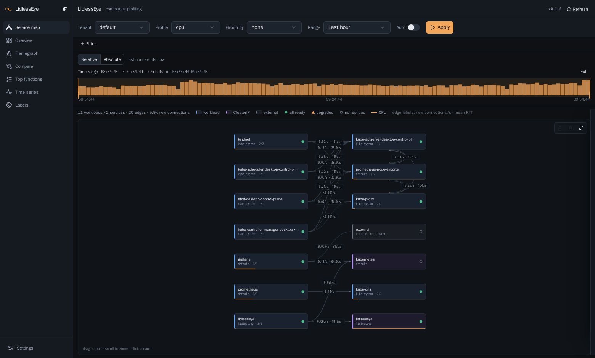
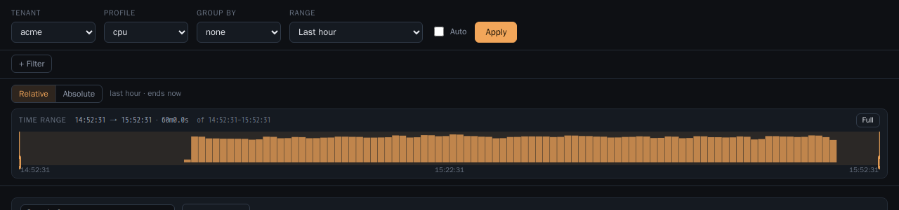
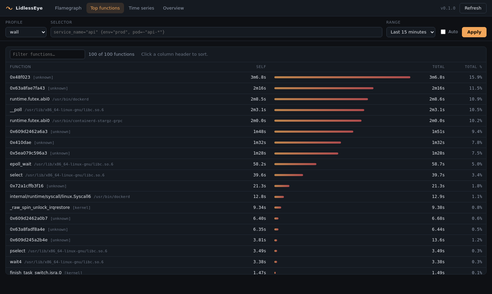

<div align="center">


**面向 Linux 的持续性能分析 —— 单个 Rust 二进制、eBPF 采集、DuckDB 存储，打开页面即是服务地图。**

[](https://github.com/xsj321/LidlessEye/actions/workflows/ci.yml)
[](https://github.com/xsj321/LidlessEye/releases)
[](https://crates.io/crates/lidlesseye)
[](LICENSE)
[](crates)
[](crates/lidlesseye-core)

[English](README.md) · [中文](README.zh-CN.md) · [Step-by-step usage](docs/USAGE.md) · [使用指南（中文）](docs/USAGE.zh-CN.md) · [AI 使用 MCP](docs/mcp.zh-CN.md) · [MCP English](docs/mcp.md) · [更新日志](CHANGELOG.md)

</div>

---

## 从这里开始

```bash
make release                                     # 先导出前端，再构建 Rust
sudo ./target/release/lidlesseye serve --agent --data-dir ./data
# 打开 http://localhost:4040
```

手边没有 Linux 机器？`./scripts/demo.sh` 会在 Docker 里铺一份演示数据并打印地址，宿主机不需要安装任何东西。

已经有工具链？同一个服务也发布在 crates.io：`cargo install lidlesseye`。它动态链接 DuckDB，`libduckdb.so` 需要在动态库搜索路径上 —— 这也是容器镜像更省事的原因。

想把它当作库使用：`cargo add lidlesseye`，从[嵌入指南](docs/embedding.md)开始。

页面默认打开**服务地图**。点击任意节点即可查看它的 SLO、副本、CPU、内存、网络、DNS，以及只属于这个工作负载的火焰图 —— 全程不必离开拓扑视图。



## 为什么选择 LidlessEye

| 选择 | 而不是 | 原因 |
| --- | --- | --- |
| DuckDB 2.0 作为存储引擎 | 手写列式格式、LSM 或时序数据库 | profile 是按时间过滤、按调用栈分组的追加行；DuckDB 已经做了这些，还附带压缩、事务和恢复，项目只需维护表结构 |
| 单一 Rust 工作区，服务端可作为 crate 使用 | 部署一个 Go 二进制 | “帮我 profile 这个进程并显示火焰图”变成一句 `builder().build()` |
| 在 agent 端符号化 | 在服务端符号化 | 服务端永远不需要被采集机器的文件系统，短生命周期进程的调用栈也能读懂 |

```
 进程            agent                        服务端
┌──────────┐  ┌────────────────┐  ┌──────────────────────────┐
│ 任意语言 │─►│ eBPF 采样      │─►│ POST /ingest → DuckDB    │
│          │  │ blazesym 符号化│  │ 查询 API + 内嵌 UI       │
└──────────┘  └────────────────┘  └────────────┬─────────────┘
                                               │ HTTP
                                      ┌────────▼─────────┐
                                      │ 服务地图 → 界面  │
                                      └──────────────────┘
```

## 能力一览

**采集** —— on-CPU（`PERF_COUNT_SW_CPU_CLOCK`）、off-CPU（`schedule` kprobe），以及把两者合并的虚拟 `wall` profile。聚合发生在内核里，开销不随采样频率增长。任意进程、任意语言：不需要 SDK、不需要 `LD_PRELOAD`、不需要重新编译。

**内存** —— 两个读取器，因为「堆」并不是一件事。Go 进程直接读运行时的 profile 链（`runtime.mbuckets`），数字就是运行时自己的口径、按它自己的采样率；其余语言——C、C++、Rust、jemalloc、mimalloc、tcmalloc、musl——在分配器入口用 uprobe 计数 `malloc`/`calloc`/`realloc`/`free`，覆盖所有走 malloc 的语言。两边都产出 `alloc_space`/`alloc_objects`（区间内分配，速率）与 `inuse_space`/`inuse_objects`（当前持有，水平量），并用 `profile_source`、`runtime` 标签区分来源，避免两种口径被相加。

**探索** —— 服务地图根据每个节点的 TCP 表和 Kubernetes Pod 元数据绘制。连线上实时标注**新建连接数/秒**和**平均 RTT**。点击节点打开非模态滑动检查器，包含一跳邻居和七个选项卡：

| 选项卡 | 回答的问题 |
| --- | --- |
| SLO | 可用性是否达到 99.9% 目标、错误率趋势、平均 RTT |
| Instances | 期望/就绪副本随时间的变化，以及 Pod 列表和所在节点 |
| CPU | 时间窗内由 on-CPU 样本换算出的核心数 |
| Memory | agent 实际发送的 heap profile 类型——优先 `inuse_space`，其次 `alloc_space`——按单位格式化，并区分「当前持有」与「本区间分配」 |
| Net | 进出吞吐、往返时延、调用方和被调用方 |
| DNS | TCP/53 对端、时延和重传 |
| Profiling | 最热函数、**该节点内嵌的火焰图**，以及跳转到完整视图 |

**分析** —— 支持搜索、缩放和面包屑的火焰图；Top-N 函数；时间序列；带结构化筛选行的标签浏览器；能把回退染红的对比视图。时间窗口的选法与 Grafana 一致：先选范围，再在其中框选关心的区间。

**让 AI 查询** —— 可选的 stdio [MCP 服务端](docs/mcp.zh-CN.md) 暴露只读工具，可查询服务地图、火焰图摘要、Top 函数、时间序列和窗口对比。结果遵循 summary first，带明确单位、查询上下文和截断标记，模型可以解释数字来源，而不需要猜测。

**运维** —— 通过 `X-Scope-OrgID` 做多租户隔离、按租户的 token 与保留策略、Prometheus 指标、`fsck` 校验命令、Docker 镜像、Helm chart，以及可嵌入的 Rust API。

 

## 性能

在单个 server 副本上测得，数据集是一个合成的 30 天电商集群：64 个服务、244 条边、687,792 份 profile、约 4100 万条调用栈样本、栈深 1022 层、磁盘占用 490 MB。没有预聚合，也没有外部索引：下面每个数字都直接扫描写入路径产生的 Parquet。

| 查询（1 小时窗口） | p50 | p95 |
| --- | ---: | ---: |
| Stats | 37 ms | 41 ms |
| 服务地图 | 41 ms | 46 ms |
| 地图直方图 | 11 ms | 33 ms |
| 时间序列 | 33 ms | 35 ms |
| Top 函数 | 135 ms | 193 ms |
| 火焰图 | 178 ms | 212 ms |

时间范围放大时，延迟随数据量增长，而不是突然爆炸：

| 窗口 | p50 | p95 |
| --- | ---: | ---: |
| 1 小时 | 167 ms | 192 ms |
| 6 小时 | 689 ms | 752 ms |
| 24 小时 | 2.8 s | 3.0 s |
| 7 天 | 6.2 s | 7.4 s |
| 30 天 | 7.8 s | 9.2 s |

30 天这一行是“看整月”触发的 4100 万行全量扫描；日常看板仍停留在几十到几百毫秒。

**并发看板。** 16 个客户端持续轮询 stats、地图、直方图和时间序列 15 秒：单副本 **34 req/s**，p50 356 ms、p95 894 ms、p99 999 ms，零错误。server 只持有一个 DuckDB 连接并串行执行查询，所以这反映的是真实看板遇到的排队，而不是人为的并行扫描。

**资源开销。** 压测期间 Prometheus 记录到 **平均 1.35 GB / 峰值 1.97 GB RSS**，**平均 1.96 / 峰值 3.39 核**（20 vCPU 节点）。30 天数据在磁盘上占 **490 MB**。

复现方式：先用 `node scripts/seed-ecommerce.mjs --profile stress` 生成数据，再运行 `node scripts/bench.mjs --base http://127.0.0.1:4040 --tenant shop-stress`。脚本打印同样的表格，并可将 JSON/Markdown 写入文件。

## 界面导览

左侧抽屉可切换服务地图、总览、Flamegraph、对比、Top 函数、时间序列和标签。单击即可折叠成图标，选择会保存在当前浏览器中。顶部栏在版本号左侧提供租户选择器，并放置刷新按钮；服务地图会隐藏与性能查询相关的工具栏，相对时间范围在时间条右侧选择。地图上方的直方图统计请求数（新建连接），而非 CPU 采样。**Settings** 位于抽屉底部，可配置界面语言（English / 简体中文）、启动视图、默认时间范围、刷新间隔、地图边标签及其缩放阈值、火焰图帧数上限和直方图分辨率。

所有视图共享 URL 中的时间窗与筛选条件。复制地址栏即可完整分享你看到的画面。完整操作见[逐步使用指南](docs/USAGE.zh-CN.md)。

## 快速开始

### 单二进制、单机

```bash
make release
sudo ./target/release/lidlesseye serve --agent --data-dir ./data
```

前置条件：Linux ≥ 5.5 且带 BTF（`/sys/kernel/btf/vmlinux`）、`clang`、root（或 `CAP_BPF` + `CAP_PERFMON` + `CAP_SYS_ADMIN`），导出前端还需要 Node 20.19+。`perf_event_paranoid` 必须 ≤ 2。首次构建会下载预编译的 `libduckdb.so`；离线构建可把副本放到某目录并设置 `DUCKDB_LIB_DIR`。从构建目录运行时设置 `LD_LIBRARY_PATH` 指向 `target/release/build/libduckdb-sys-*/out`。

```bash
./scripts/demo.sh                # 无需 root、无需 eBPF，只要 Docker
./scripts/demo.sh --stop

# 或者用发布镜像（由 deploy/docker/Dockerfile 构建，同一 digest 镜像到
# ghcr.io/xsj321/lidlesseye）
docker run --rm -p 4040:4040 -v lidlesseye-data:/var/lib/lidlesseye \
  docker.io/xsj321/lidlesseye:0.1.2
```

### 服务端 + agent

```bash
# 存储节点
lidlesseye serve --data-dir /var/lib/lidlesseye --listen 0.0.0.0:4040 --retention 7d

# 每个节点
sudo lidlesseye collect --server http://storage:4040 --frequency 99
```

Kubernetes 中，Helm chart 会创建服务端 `Deployment` 和特权 agent `DaemonSet`；agent 列出本节点上的 Pod，因此 profile 以工作负载命名：

```bash
helm install lidlesseye deploy/helm/lidlesseye \
  --namespace observability --create-namespace \
  --set server.persistence.size=100Gi \
  --set server.auth.enabled=true
```

存储默认为每个租户一个 DuckDB 文件。对于数据量大或留存期长的场景，`--set server.storage.mode=parquet` 可切换到分层 Parquet + S3 存储（内存热层 → 本地 Parquet → 每小时归档到 S3，查询通过 DuckDB 零拷贝扫描读回）；凭证和端点在 `server.storage.s3` 下配置。两种模式与完整参数见 [deployment.md](docs/deployment.md)。

## 嵌入自己的程序

```toml
[dependencies]
lidlesseye = "0.1"
```

```rust
use lidlesseye::{LidlessEye, Result};

#[tokio::main]
async fn main() -> Result<()> {
    let eye = LidlessEye::builder()
        .data_dir("./profiles")
        .listen("127.0.0.1:4040")
        .agent(true)
        .service_name("my-service")
        .frequency_hz(99)
        .build()
        .await?;
    eye.run().await
}
```

`agent(false)` 只提供存储与 HTTP API。可运行示例：`cargo run --example embed`、`cargo run --example synthetic`。

工作区发布的 crate：

| Crate | 职责 |
| --- | --- |
| `lidlesseye` | 二进制与嵌入入口 |
| `lidlesseye-server` | HTTP API 与内嵌看板 |
| `lidlesseye-core` | DuckDB/Parquet 存储与查询引擎 |
| `lidlesseye-ebpf` | eBPF 程序与 BPF 侧辅助函数 |
| `lidlesseye-servicemap` | 服务地图模型、协议常量与纯查询逻辑 |
| `lidlesseye-mcp` | 面向 AI 客户端的只读 MCP 工具 |

## HTTP API

| 方法 | 路径 | 说明 |
| --- | --- | --- |
| `POST` | `/ingest` | 单个 report 或 `{"reports": [...]}` |
| `GET` | `/api/v1/flamegraph` | 嵌套或扁平的调用栈树 |
| `GET` | `/api/v1/top` | 按 self value 排序的热点函数 |
| `GET` | `/api/v1/timeseries` · `/api/v1/series` | 按桶聚合的时间序列 |
| `GET` | `/api/v1/label-names` · `/api/v1/label/{name}/values` | 标签浏览 |
| `GET` | `/api/v1/diff` | 两个时间窗放在同一棵树中对比 |
| `GET` | `/api/v1/profile_types` | 现有 profile 类型，包含 `wall` |
| `GET` | `/api/v1/servicemap` · `/api/v1/servicemap/history` | 拓扑与单节点历史 |
| `GET` | `/api/v1/tenants` · `/api/v1/health` · `/stats` · `/version` | 运维 |
| `GET` | `/metrics` | Prometheus 文本格式 |

常用参数：`profile_type`、`from`、`until`（unix 秒、`1700000000ms`、RFC3339、`now-1h`）、`selector`、`group_by`、`max_nodes`、`limit`、`step`、`buckets`。请求通过 `X-Scope-OrgID` 指定租户；不传时使用 `default`。

```bash
curl -s 'http://localhost:4040/api/v1/top?profile_type=cpu&from=now-1h&limit=5' | jq
curl -s 'http://localhost:4040/api/v1/servicemap?from=now-1h' | jq '.nodes | length'
```

## 通过 MCP 让 AI 查询

```bash
cargo build --release -p lidlesseye-mcp
./target/release/lidlesseye-mcp --base-url http://127.0.0.1:4040 --tenant default
```

把这个二进制注册到 MCP 客户端（Claude Desktop、IDE agent 或其它 MCP host）。常用工具包括 `list_tenants`、`get_service_map`、`get_service_map_histogram`、`get_top`、`get_flamegraph_summary`、`get_timeseries` 和 `diff_profiles`。每个结果都包含 `summary`、`query_context`、`unit`、`truncated`、有限的 `data` 和 `suggestions`。配置、完整工具表和推荐排查顺序见 [docs/mcp.zh-CN.md](docs/mcp.zh-CN.md)。

## 命令行

```
lidlesseye serve    # HTTP 服务端，可选 --agent
lidlesseye collect  # eBPF 采集器，推送到服务端
lidlesseye ingest   # 导入 JSON / pprof / folded 报告
lidlesseye query    # 检查数据目录
lidlesseye fsck     # 校验数据库完整性
lidlesseye info     # 构建与平台信息
```

`collect` 支持 `--frequency`、`--flush`、`--label k=v`、`--service-name`、`--no-cpu`、`--no-offcpu`、`--no-heap`、`--no-alloc`、`--heap-objects`、`--no-k8s-labels`、`--no-k8s-pod-metadata`、`--k8s-pod-refresh`、`--server`、`--tenant`、`--auth-token` 和 `--duration`。设置 `LIDLESSEYE_NODE_NAME`（Helm chart 传入 `spec.nodeName`）可让 `node` 标签在滚动更新后保持稳定。

完整参考：[HTTP API](docs/api.md) · [MCP](docs/mcp.zh-CN.md) · [架构](docs/architecture.md) · [部署](docs/deployment.md) · [界面](docs/ui.md)。

## 测试

```bash
cargo test --workspace
cargo clippy --workspace --all-targets -- -D warnings
cargo fmt --all --check
./scripts/ui-smoke.sh          # Chromium：遍历所有视图、抽屉、设置与深链
./scripts/deploy-smoke.sh      # 镜像：导入、查询、租户隔离
```

浏览器测试会为两个租户铺数据，并在任何控制台错误时失败 —— 渲染回归不会被当成“API 没问题”。

## 限制

- **采集仅支持 Linux**。存储和查询 API 是可移植的 Rust。
- **在导入时符号化**：无法读取模块的帧会显示为 `[unknown]`；agent 需要 `hostPID` 和二进制文件的读权限。
- **每个 agent 只能覆盖一个 PID namespace**：其他容器中的进程会被计为 `in another PID namespace`，不会被错误归属。
- **单机存储**：一个存储卷对应一个服务端，没有集群或复制。
- **uprobe 需要显式开启且范围有限**：TLS 明文捕获仍在 `LIDLESSEYE_SSL_UPROBE=1` 之后；分配分析默认开启（`--no-alloc` 关闭），每个容器每种分配器只挂一个文件——glibc、musl、jemalloc、mimalloc 或 tcmalloc，取进程实际映射的那一个。
- **用户态调用栈需要 frame pointers**（`-C force-frame-pointers=yes` / `-fno-omit-frame-pointer`）。没有它们时耗时统计依然正确。
- **内存分析看的是「分配」，不是「内存」**：`inuse_*` 只统计探针看到分配过、且还没释放的块，所以挂载之前分配的内存、`mmap` 出来的 arena、以及完全绕过 `malloc` 的分配器都不在范围内；也没有 RSS / PSS 序列可以拿来跟堆的水平量对照。

## 文档

| 文档 | 回答什么 |
| --- | --- |
| [使用指南](docs/USAGE.zh-CN.md) · [English](docs/USAGE.md) | 看板、时间范围、筛选、CLI，上手第一小时 |
| [架构](docs/architecture.md) | eBPF 采集、导入、DuckDB 与服务地图如何串起来，以及为什么这样选 |
| [HTTP API](docs/api.md) | 每个端点、参数与返回结构 |
| [MCP](docs/mcp.zh-CN.md) · [English](docs/mcp.md) | 安装 stdio MCP 服务端、工具清单、AI 友好的返回结构与排查流程 |
| [部署](docs/deployment.md) | Helm values、存储模式、S3 归档、保留期、配额 |
| [看板与 UI 规则](docs/ui.md) | 每个视图展示什么，以及前端必须遵守的设计规则 |
| [嵌入](docs/embedding.md) | 把服务端当作 Rust crate 使用 |
| [多租户](docs/multi-tenancy.md) | token、`X-Scope-OrgID` 与隔离保证 |
| [兼容性](docs/compatibility.md) | 内核、发行版、Kubernetes 版本 |
| [更新日志](CHANGELOG.md) | 每个版本改了什么 |

## 参与贡献

欢迎提 issue 和 pull request。[CONTRIBUTING.md](CONTRIBUTING.md) 说明了改动必须通过的检查与看板的设计规则；[SECURITY.md](SECURITY.md) 说明如何私下报告安全问题。发布由 tag 驱动 —— `git tag v0.1.2 && git push origin v0.1.2` —— `.github/workflows/release.yml` 会发布说明与 Helm chart。

## 许可证

仓库整体使用 Apache-2.0，**例外**是 `crates/lidlesseye-ebpf/bpf/profile.bpf.c`：因为内核拒绝加载调用 GPL-only helper 却未声明兼容许可证的 BPF 程序，该文件为 GPL-2.0-only。参见 [LICENSE](LICENSE)、[LICENSE-BPF](LICENSE-BPF) 和 [NOTICE](NOTICE)。
