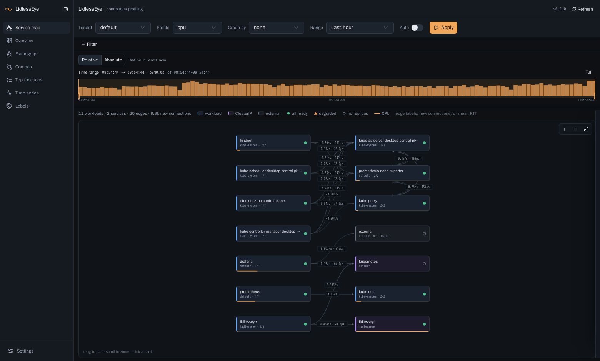

# Using the LidlessEye dashboard

A step-by-step guide for operators. [中文版](USAGE.zh-CN.md) · [README](../README.md) · [UI reference](ui.md)

The dashboard is embedded in the server. You do not need to install a frontend separately.

---

## 1. Start something to look at

The fastest path is the seeded demo:

```bash
./scripts/demo.sh
```

It builds the server, starts it on `127.0.0.1:4040`, seeds three services with CPU and off-CPU profiles, and prints the URL. Stop it with `./scripts/demo.sh --stop`. Docker is the only requirement.

On a real Linux host with BTF:

```bash
sudo ./target/release/lidlesseye serve --agent --data-dir ./data
```

For a distributed setup, run `lidlesseye serve` on a storage host and `lidlesseye collect --server http://storage:4040` on every node.

Open <http://localhost:4040>. A bare URL opens the **service map**.

---

## 2. Learn the layout

```
┌──────────┬──────────────────────────────────────────────────────────┐
│ Service  │ LidlessEye                            v0.1.0   Refresh  │
│ map      ├──────────────────────────────────────────────────────────┤
│ Overview │ Tenant · Profile · Group by · Range · Auto · Apply      │
│ Flame…   ├──────────────────────────────────────────────────────────┤
│ Compare  │ Filter                                                  │
│ Top …    ├──────────────────────────────────────────────────────────┤
│ Time …   │ Relative | Absolute    [histogram with draggable bracket]│
│ Labels   ├──────────────────────────────────────────────────────────┤
│          │                                                          │
│ Settings │                     main view                            │
└──────────┴──────────────────────────────────────────────────────────┘
```

- **Left drawer** — switches the whole page. The highlighted item has `aria-current="page"`.
- **Top row** — build version and manual `Refresh` (keyboard `R`).
- **Toolbar** — tenant, profile type, grouping, relative range, auto-refresh.
- **Filter bar** — structured label matchers.
- **Time bar** — relative/absolute mode and the histogram with a draggable window bracket.
- **Main** — the view itself. Only this pane scrolls.

---

## 3. Navigate and collapse the drawer

1. Click **Service map**, **Overview**, **Flamegraph**, **Compare**, **Top functions**, **Time series**, or **Labels** in the left drawer.
2. Click the **collapse** button at the drawer's top right. The drawer shrinks to icons; hover an icon for its name. Click the same button again to expand.
3. The collapsed state is stored in this browser and survives a reload.

The URL hash changes with the view, e.g. `#/servicemap?type=cpu&range=1h&...`. Copy the address bar to send someone the exact screen.

---

## 4. Set the time window

Two levels, in this order:

1. **Domain** — the span the histogram draws. In the toolbar, pick a relative preset from **Range** (`5m`, `15m`, `1h`, `6h`, `24h`, `7d`) or choose **Custom range** and switch the time bar to **Absolute**, fill **From** and **To**, then click **Apply**.
2. **Window** — the bracket inside the domain. It is what every query uses. Drag the shaded bracket in the histogram to move it, drag its edges to resize, or click elsewhere to jump. `Reset` restores the whole domain.

`Auto` toggles periodic reloading. Its interval is configured in Settings (default 30 s). With a relative domain, the window follows the clock; an absolute domain stays pinned.

Once the window is set, click **Hide chart** at the right of the time bar to collapse the histogram and give the main view more room; **Show chart** brings it back with the same window still selected. The choice is remembered in this browser.

---

## 5. Read the service map

The map is a left-to-right graph: entry points on the left, what they call on the right.

- **Card colour bar** — workload (blue), ClusterIP service (violet), external endpoint (amber).
- **Status glyph** — green dot: all replicas ready; amber triangle: degraded; hollow circle: no replicas reported.
- **CPU heat bar** — a thin strip on each card shows on-CPU time relative to the busiest node.
- **Edge label** — `connections/s · mean RTT`. Labels are placed to avoid cards and each other; on a crowded wire only the rate survives. They appear once the map is zoomed in past the threshold in Settings (default 62 %). Red dashed edges are retransmitting.

Use the `+` / `−` buttons to zoom, the fit button to frame the whole graph, and drag the background to pan.



---

## 6. Inspect a node

Click a card. A panel slides in from the right **over** the map — the map stays clickable, so you can walk the graph one hop at a time.

- **Neighbours** shows callers and callees as small cards. Click one to make it the inspected node.
- The panel fills the full window height. To make room for wide charts, drag its **left edge** to the left; the new width is remembered across reloads. Keyboard: focus the edge, then use `←` / `→` (or `Shift` for bigger steps) and `Home` to reset.
- Close the panel with `×` or `Escape`. Focus returns to the card that opened it.

The seven tabs answer different questions:

| Tab | What to look at |
| --- | --- |
| **SLO** | Availability against the 99.9 % objective, error rate over time (retransmits are the failure proxy), mean RTT. |
| **Instances** | Desired vs ready replicas over the window and the sampled pod list with each pod's node. |
| **CPU** | Cores over time, derived from on-CPU samples divided by their bucket width. |
| **Memory** | The heap profile type actually present, using its declared unit. If the agent only sends CPU profiles, the tab says so. |
| **Net** | In/out throughput, RTT samples, and the caller/callee lists with per-hop rates. |
| **DNS** | TCP/53 peers, mean RTT and retransmits. UDP lookups are not captured. |
| **Profiling** | Hottest functions, **the flamegraph for this node**, and a button to open that selector in the full flamegraph view. |

### The embedded flamegraph

The Profiling tab runs a second query with the same time window and the node's own label selector (`k8s_namespace` + `k8s_workload`, or `service_name` for a ClusterIP). It shows:

- **Search frames…** — filters frame names; the match count appears to the right.
- Click a frame to zoom; the breadcrumb above the canvas shows where you are. Click a crumb to go back, or press `Escape`. **Reset zoom** returns to the full tree.
- Hover a frame for its self/total values and percentage. Width is inclusive time; colour is chosen by frame group.

An external node has no profiles behind it, so the tab explains the gap instead of drawing the whole cluster's stacks under that name.

---

## 7. Use the full Flamegraph view

Pick **Flamegraph** in the drawer. It searches across all services using the current profile type, window and filters.

- Click a frame to zoom into it. The zoom is animated; `Escape` steps back out.
- The bar at the top shows the selected range and the samples it covers.
- Choose `off_cpu` in **Profile** to see where processes block; `wall` merges CPU and off-CPU.
- **Group by** a label (`service_name`, `pod`, …) to split frames by that dimension.

---

## 8. Compare two windows

Pick **Compare**. The time bar now shows two brackets: **baseline** and **comparison**.

1. Choose a domain wide enough to contain both windows.
2. Drag each bracket to the interval you want.
3. Red frames grew in the comparison window; green frames shrank. The legend reports the totals for both sides.

---

## 9. Filter by label

Two ways:

- **Filter bar** — click `+ Filter`, choose a label, an operator (`=`, `!=`, `=~`, `!~`) and a value. Add as many rows as you need. A pasted raw selector is kept verbatim.
- **Labels view** — pick a label on the left, then click a value on the right. This writes a filter row and jumps to the flamegraph.

Filters apply to profile views. The service map is a network view and deliberately ignores them, so it cannot claim to show a filtered topology.

---

## 10. Work with tenants

When the server has more than one tenant, **Tenant** appears in the toolbar. Switching it re-runs every query. `?tenant=acme` in the query string selects that tenant on a pasted link; an explicit hash parameter still wins.

Tokens are bound to tenants with `--tenant-token`. If a 403 appears, either switch to the tenant the token allows or clear `lidlesseye.tenant` from local storage.

---

## 11. Tune the dashboard

Click **Settings** at the bottom of the drawer.

| Setting | Effect |
| --- | --- |
| Default view | Landing page when the URL does not name one (default: Service map). |
| Default range | Relative range on a fresh load (default: last hour). |
| Auto-refresh interval | 10 s / 30 s / 1 min / 5 min. Takes effect immediately if Auto is on. |
| Edge labels | Show or hide the rate/RTT pills on the map. |
| Label zoom threshold | Zoom level from which labels appear (0 = always, 100 = never). |
| Flamegraph frame cap | 10 000 / 50 000 / 100 000 frames per request. |
| Histogram buckets | 60 / 120 / 240; higher means a finer brush. |

Settings live in this browser's local storage. They are **not** encoded in the URL, so a shared link always reproduces the same screen. **Reset to defaults** restores all of them.

---

## 12. When a view is empty

- **Service map: "No traffic in this range"** — the map reads TCP tables from each node. Widen the range, or check that the agent is running with pod metadata enabled (`--k8s-pod-refresh`).
- **Flamegraph: "No samples yet"** — an agent has not reported yet. The empty state shows the exact `lidlesseye collect` command to run.
- **"No stacks matched this node"** — the workload's labels do not match the agent's `k8s_*` labels. Check `--no-k8s-labels` / `--no-k8s-pod-metadata`.
- **A range with no data** — the time bar offers a `use` link that jumps to the range that actually holds samples.
- **401 / 403** — the server requires a token or the tenant is not allowed; see [multi-tenancy](multi-tenancy.md).

For every control and gesture, see [docs/ui.md](ui.md).
