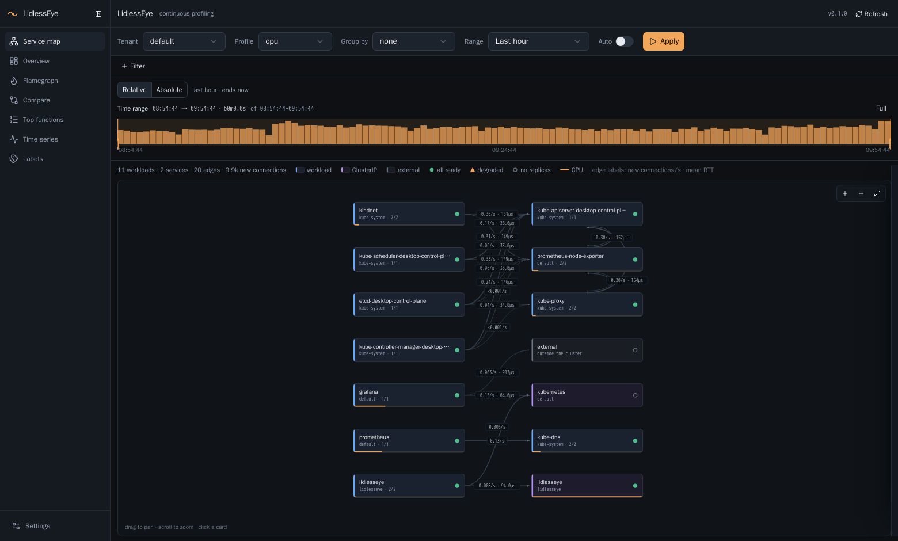

# 使用 LidlessEye 仪表盘

面向操作者的逐步指南。[English](USAGE.md) · [README](../README.zh-CN.md) · [界面参考](ui.md)

仪表盘已内嵌在服务端中，不需要单独部署前端。

---

## 1. 先准备可查看的数据

最快的方式是使用演示数据：

```bash
./scripts/demo.sh
```

它会构建服务端、在 `127.0.0.1:4040` 启动、为三个服务铺好 CPU 与 off-CPU profile，并打印访问地址。用 `./scripts/demo.sh --stop` 停止。唯一依赖是 Docker。

在带 BTF 的真实 Linux 主机上：

```bash
sudo ./target/release/lidlesseye serve --agent --data-dir ./data
```

分布式部署则在存储节点运行 `lidlesseye serve`，在每个节点运行 `lidlesseye collect --server http://storage:4040`。

打开 <http://localhost:4040>。不带路径的地址会进入**服务地图**。

---

## 2. 认识界面布局

```
┌──────────┬──────────────────────────────────────────────────────────┐
│ 服务地图 │                              租户  v0.1.0   刷新         │
│ 总览     ├──────────────────────────────────────────────────────────┤
│ 火焰图   │ Profile · Group by · Range · Auto · Apply（仅性能视图）  │
│ 对比     ├──────────────────────────────────────────────────────────┤
│ Top 函数 │ Filter                                                   │
│ 时间序列 ├──────────────────────────────────────────────────────────┤
│ 标签     │ 相对 | 绝对   最近 1 小时 ▾  [直方图 + 可拖动时间窗]     │
│          ├──────────────────────────────────────────────────────────┤
│ Settings │                     主视图                               │
└──────────┴──────────────────────────────────────────────────────────┘
```

- **左侧抽屉**：切换整个页面。高亮项带有 `aria-current="page"` 语义。
- **顶部行**：租户选择器（在版本号左侧）和手动 `Refresh`（快捷键 `R`）。这里不再重复显示标题，品牌名只在抽屉中。
- **工具栏**：profile 类型、分组、相对范围、自动刷新。服务地图会隐藏这一行，因为这些控件与网络视图无关。
- **筛选栏**：结构化的标签匹配行。
- **时间条**：相对/绝对模式、相对范围选择器，以及带可拖动窗口括号的直方图。
- **主视图**：只有这一区域会滚动。

---

## 3. 切换与折叠抽屉

1. 在左侧抽屉点击 **服务地图 / 总览 / Flamegraph / 对比 / Top 函数 / 时间序列 / 标签**。
2. 点击品牌名旁边的**折叠**按钮，抽屉收缩为图标；悬停图标可看到名称。折叠后顶部的按钮会隐藏，**展开**按钮出现在图标列表的最后一项，点击它即可展开。
3. 折叠状态保存在当前浏览器中，刷新后依然有效。

URL hash 会随视图变化，例如 `#/servicemap?type=cpu&range=1h&...`。复制地址栏即可把当前画面发给别人。

---

## 4. 选择时间窗

分两层，按此顺序设置：

1. **域（Domain）** —— 直方图绘制的跨度。**Relative** 模式下，在时间条右侧的范围选择器中选预设（`5m`、`15m`、`1h`、`6h`、`24h`、`7d`）；性能视图的工具栏中也有同样的 **Range** 控件，并提供 **Custom range**。要自定义窗口，可把时间条切到 **Absolute**，填写 **From** 和 **To** 后点击 **Apply**。
2. **窗（Window）** —— 域内的括号，所有查询都使用它。在直方图中拖动阴影括号可移动；拖动边缘可缩放；在别处点击可跳转。`Reset` 恢复整个域。

`Auto` 控制周期性刷新，间隔在 Settings 中配置（默认 30 秒）。相对域会随时间前进，绝对域保持固定。

窗口确定后，可点击时间条右侧的 **Hide chart** 折叠直方图，把空间让给主视图；点击 **Show chart** 可恢复，原先选中的窗口仍会保留。该选择会保存在当前浏览器中。

---

## 5. 读懂服务地图

地图从左到右：入口在左，它调用的服务在右。

- **卡片色条** —— 工作负载（蓝）、ClusterIP 服务（紫）、外部端点（琥珀）。
- **状态图形** —— 绿色圆点：副本全部就绪；琥珀三角：降级；空心圆：没有副本上报。
- **CPU 热度条** —— 卡片上的细条表示相对最忙节点的 on-CPU 时间。
- **边标签** —— `连接数/秒 · 平均 RTT`。标签会避开卡片和彼此；拥挤的连线只保留速率。缩放超过 Settings 中的阈值（默认 62%）后才显示。红色虚线表示发生重传。

地图上方的直方图标记为 **请求数**：每一根柱子统计该时间段内所有连线上新建的连接数，而不是 CPU 采样数。它回答的是“这张拓扑图对应的系统在什么时候繁忙”。

用 `+` / `−` 缩放，用适应按钮框选整图，拖动背景平移。



---

## 6. 检查节点

点击卡片，面板从右侧滑入并**覆盖**地图 —— 地图仍可点击，因此可以一跳一跳地走图。

- **Neighbours** 用卡片展示调用方和被调用方。点击其中一张即切换检查对象。
- 面板占据整个窗口高度。需要给宽图表更多空间时，**向左拖动面板左边缘**即可加宽，宽度会在刷新后保留。键盘操作：聚焦边缘后用 `←` / `→` 微调（按住 `Shift` 步长更大），`Home` 恢复默认宽度。
- 用 `×` 或 `Escape` 关闭面板，焦点会回到最初打开它的卡片。

七个选项卡回答不同问题：

| 选项卡 | 查看内容 |
| --- | --- |
| **SLO** | 相对 99.9% 目标的可用性、错误率趋势（以重传作为失败代理）、平均 RTT。 |
| **Instances** | 时间窗内期望与就绪副本，以及采样到的 Pod 列表和所在节点。 |
| **CPU** | 由 on-CPU 样本除以桶宽得到的核心数曲线。 |
| **Memory** | 实际存在的 heap profile 类型，按其声明的单位显示。若 agent 只上报 CPU profile，选项卡会明确说明。 |
| **Net** | 进出吞吐、RTT 样本、调用方与被调用方列表及逐跳速率。 |
| **DNS** | TCP/53 对端、平均 RTT 和重传。UDP 查询不会被采集。 |
| **Profiling** | 最热函数、**该节点的火焰图**，以及在完整火焰图视图中打开该选择器的按钮。 |

### 内嵌火焰图

Profiling 选项卡用相同的时间窗和该节点自身的标签选择器（`k8s_namespace` + `k8s_workload`，ClusterIP 则用 `service_name`）发起第二次查询。图中：

- **Search frames…** 过滤帧名，右侧显示匹配数量。
- 点击帧可缩放；画布上方的面包屑显示当前位置。点击面包屑返回，或按 `Escape`。**Reset zoom** 回到完整树。
- 悬停帧可看到 self/total 值和占比。宽度表示包含时间，颜色按帧分组。

外部节点背后没有 profile，因此选项卡会解释原因，而不是把整个集群的调用栈画在这个名字下面。

---

## 7. 使用完整火焰图视图

在抽屉中选择 **Flamegraph**。它按当前的 profile 类型、时间窗和筛选条件跨所有服务搜索。

- 点击帧可放大，`Escape` 逐步返回。
- 顶部条显示所选范围和覆盖的样本数。
- 在 **Profile** 中选择 `off_cpu` 查看进程阻塞位置；`wall` 合并 CPU 与 off-CPU。
- **Group by** 某个标签（`service_name`、`pod` 等）可按该维度拆分帧。

---

## 8. 对比两个时间窗

选择 **Compare**。时间条出现两个括号：**baseline** 和 **comparison**。

1. 选择一个足够宽的域，能同时容纳两个窗口。
2. 分别拖动两个括号到目标区间。
3. 红色帧表示在 comparison 窗口中增长，绿色表示缩小。图例给出两侧的总量。

---

## 9. 按标签筛选

两种方式：

- **筛选栏** —— 点击 `+ Filter`，选择标签、操作符（`=`、`!=`、`=~`、`!~`）和值。可以增加多行；粘贴的原始 selector 会原样保留。
- **标签视图** —— 左侧选标签，右侧点击某个值，会写入一行筛选并跳转到火焰图。

筛选只作用于 profile 视图。服务地图是网络视图，会刻意忽略筛选条件，避免呈现“被筛选过的拓扑”这种误导。

---

## 10. 多租户

当服务端有多个租户时，顶部行（版本号左侧）出现 **Tenant** 选择器。切换后所有查询重新执行。粘贴的链接中 `?tenant=acme` 会选中该租户；hash 中显式的参数优先级更高。

Token 通过 `--tenant-token` 绑定租户。出现 403 时，要么切换到 token 允许的租户，要么清除 localStorage 中的 `lidlesseye.tenant`。

---

## 11. 调整仪表盘

点击抽屉底部的 **Settings**。

| 设置 | 作用 |
| --- | --- |
| Language（语言） | `English` 或 `简体中文`。切换后立即生效，并保存在当前浏览器中。 |
| Default view | URL 未指定视图时的落地页（默认：服务地图）。 |
| Default range | 首次加载使用的相对范围（默认：最近一小时）。 |
| Auto-refresh interval | 10 秒 / 30 秒 / 1 分钟 / 5 分钟。Auto 开启时立即生效。 |
| Edge labels | 显示或隐藏地图边上的速率/RTT 标签。 |
| Label zoom threshold | 标签出现的缩放级别（0 = 始终，100 = 从不）。 |
| Flamegraph frame cap | 每次请求 10 000 / 50 000 / 100 000 帧。 |
| Histogram buckets | 60 / 120 / 240；越大刷选越精细。 |

设置保存在当前浏览器的 localStorage 中，**不写入 URL**，因此分享链接总能复现同一画面。**Reset to defaults** 可全部恢复。

---

## 12. 视图为空时怎么办

- **服务地图提示 “No traffic in this range”** —— 地图读取各节点的 TCP 表。请扩大时间范围，或检查 agent 是否启用了 Pod 元数据（`--k8s-pod-refresh`）。
- **火焰图提示 “No samples yet”** —— agent 尚未上报。空状态会给出可直接运行的 `lidlesseye collect` 命令。
- **“No stacks matched this node”** —— 工作负载标签与 agent 的 `k8s_*` 标签不匹配。检查 `--no-k8s-labels` / `--no-k8s-pod-metadata`。
- **选中的范围没有数据** —— 时间条会提供 `use` 链接，跳到真正有样本的范围。
- **401 / 403** —— 服务端要求 token，或租户不被允许；参见[多租户文档](multi-tenancy.md)。

所有控件与手势详见 [docs/ui.md](ui.md)。
