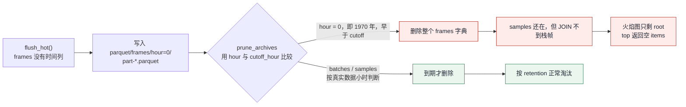
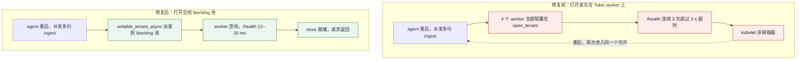
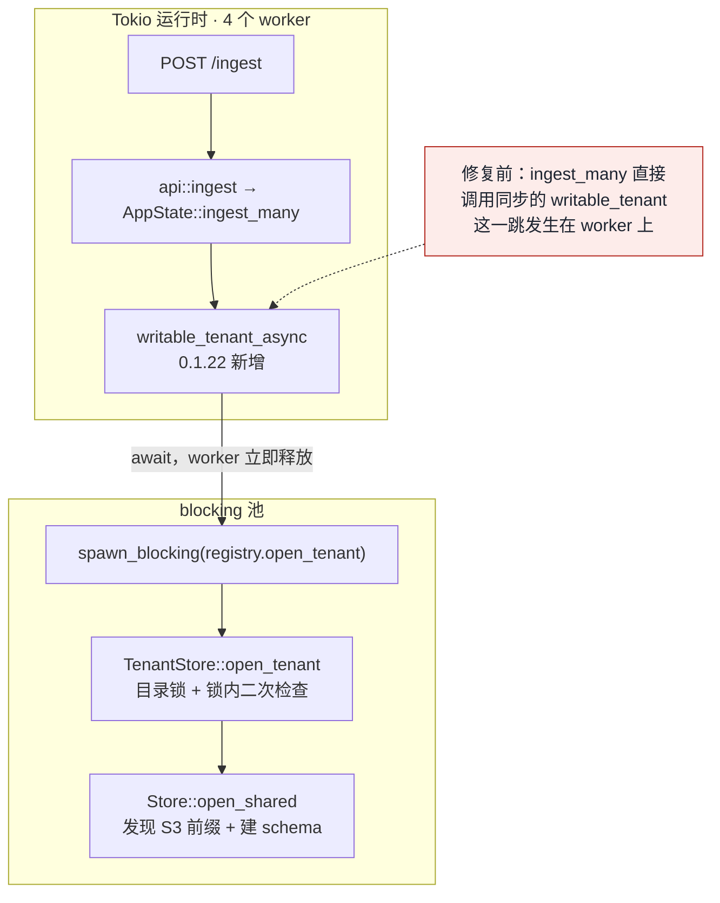
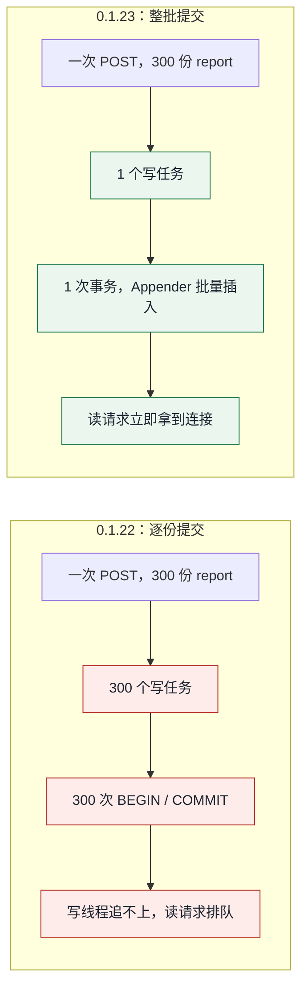
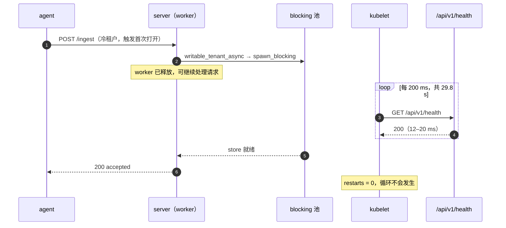

# 变更说明：0.1.21 / 0.1.22 / 0.1.23

- 日期：2026-11-25
- 范围：`lidlesseye-core`、`lidlesseye-server`、Helm chart、镜像与集群部署
- 提交：`d69c4e5`（0.1.21）、`edea4a3`（0.1.22）、0.1.23 见文末
- 发布：tag `v0.1.21`、`v0.1.22`、`v0.1.23`，镜像同名

本轮从「disk 模式集群验证」出发，修复了两个互相独立、但都会让面板「看起来坏了」的缺陷；顺带把上一轮实验遗留的部署漂移还原成 chart 默认值。

| 版本 | 主题 | 影响面 |
| --- | --- | --- |
| 0.1.21 | retention 删掉整张栈帧字典 | disk 模式火焰图只剩根、`top` 为空；数据不可恢复 |
| 0.1.22 | 冷租户首次打开占用 Tokio worker | S3 模式冷开期间健康检查超时 → 容器被杀 → 重启循环 |
| 运维 | `lidlesseye` 实例恢复 chart 默认探针与参数 | 去掉 `--duckdb-threads=1` 与放宽的 liveness/readiness |
| 0.1.23 | 写放大 + 负数计数器 | 单次上传从 N 个事务降到 1 个；一批坏数据不再整批丢弃 |

## 一、0.1.21：retention 删掉栈帧字典

### 现象

disk 模式的实例里，服务地图正常（14 节点 / 31 条边），但火焰图只有 `root` 一个节点，`top` 的 items 为空。查询没有报错，看起来像「查询逻辑坏了」。

### 定位

落盘目录里 `stacks` 有 7 个 parquet 文件，`frames` 一个都没有。`frames` 是没有时间列的字典表，按设计写入 `hour=0` 这个哨兵目录（表示不分片）；而 `prune_archives` 把目录名当小时解析，`hour=0` 等于 1970 年，第一次 retention 就把整张帧字典删掉了，引用它的 `samples` 却还在。

> 图 1：`hour=0` 是「不分片」的哨兵，被当成日期后走入红色分支。查询本身没问题，是数据被删了。

### 变更

`crates/lidlesseye-core/src/parquet.rs` · `prune_archives`

对没有时间列的表（`hour_column.is_none()`，即 `frames` 和旧布局的 `stacks`），把 `hour=0` 视为「无日期」，与没有 hour 标记的文件同等对待：

- retention 不再按小时删除它；
- 只有磁盘上限淘汰才会删除，且作为独立单元排在最末（先淘汰有日期的旧数据）。

语义与原有注释一致——「无法判定日期的文件，宁可保留也不猜」。

### 测试

新增单元测试 `retention_keeps_the_unsharded_frame_dictionary`（`store.rs`）：

1. 写入一份 profile → `flush_hot()` 落盘；
2. 断言 `frames/hour=0` 下存在 parquet 文件；
3. 执行 `prune(now)`（retention 1h，数据就在当前小时）；
4. 断言帧文件仍在；
5. 用 `lidlesseye_core::flamegraph()` 查询，断言能解析出叶子帧。

反证：把修复改成 `if false && ...` 后重跑，测试失败并输出 `retention deleted the unsharded frame dictionary`。

## 二、0.1.22：冷租户首次打开占住 Tokio worker

### 现象

S3 模式冷开一个租户需要 20–100 秒。这段时间里 `/api/v1/health` 超时，liveness 连续 3 次失败后容器被杀，重启后再次冷开，形成重启循环。

### 定位

`maybe_store` 在 0.1.20 已经改成走 `spawn_blocking`，但**写路径没有**：`ingest_many`、`ingest_servicemap`、`flush`、`servicemap_ingest` 都直接调用同步的 `writable_tenant`。agent 重启后一次性补发多份 report，几个请求就能把 4 个 worker 全部阻塞在同一个 `open_tenant` 上。

> 图 2：同一个冷开，修复前它占着运行时并把进程拖进重启循环；修复后它只占 blocking 池的一个线程。

### 变更

`crates/lidlesseye-server/src/lib.rs` · 新增 `AppState::writable_tenant_async`

- 内部 `spawn_blocking(registry.open_tenant)`，把打开放到 blocking 池；
- `open_tenant` 自带按目录的打开锁和锁内二次检查，并发调用者现在在 blocking 池上排队，**同一次打开只会执行一次**；
- drop 掉 future 不会取消进行中的打开：blocking 任务跑完照样缓存 store，下一个调用者直接命中缓存；
- 同步的 `AppState::store()` / `tenant_store()` 保持不变（非 async 上下文仍在用）。

四个调用点改为 `.await`：`api.rs` 的 `flush`、`servicemap_ingest`，`lib.rs` 的 `ingest_many`、`ingest_servicemap`。

> 图 3：调用链只挪动了一处——跨过运行时与 blocking 池的边界。`open_tenant` 内部的打开锁保证并发的多个请求共享同一次打开。

### 测试

新增集成测试 `a_cold_tenant_open_is_awaited_off_the_runtime`（`tests/http_api.rs`）：

用手工 `Waker` 对 `writable_tenant_async` 返回的 future 只 poll 一次，断言结果是 `Poll::Pending`。`spawn_blocking` 必然如此，而任何内联打开都会在首次 poll 就 `Ready`；随后用 10 s 超时等待它完成，验证缓存路径可用。

反证：把测试里的调用换成 `async { state.writable_tenant(&tenant) }` 后，断言失败并输出 `a cold tenant was opened inline on the runtime thread`。

## 三、运维变更：`lidlesseye` 恢复 chart 默认值

上一轮排查遗留的手工 patch，已按 release manifest 还原（镜像仍为 0.1.22，manifest 里的 0.1.18 是 chart 的 `appVersion`，回退会丢修复）：

| 项 | 还原前 | 现在 |
| --- | --- | --- |
| 启动参数 | 多一个 `--duckdb-threads=1` | 移除，与 chart 渲染的 17 个参数一致 |
| livenessProbe | 180 s / 10 s / 6 次 | 5 s / 20 s / 3 s / 3 次 |
| readinessProbe | 10 s / 5 s / 12 次 | 2 s / 10 s / 1 s / 3 次 |

## 四、0.1.23：写入放大，以及整批丢数据

### 现象

页面一段时间没有新数据，服务端日志持续出现 `the write queue was full for 30s`、`a background pass did not finish within 600s`；agent 侧出现 `dropping reports after a permanent server error ... value 18446744073709551615`。

### 两个根因

1. **负数计数器**：BPF 在 `free` 时用 `0 - size` 扣减 `inuse_*`。进程在探针 attach 之前分配、之后释放时，计数变成负数，按 `u64` 读就是 `u64::MAX`。服务端按非法值拒绝**整个上传**，agent 重试 9 次后把 64 份报告一起丢掉。
2. **写放大**：`ingest_many` 逐份追加，一份报告一个写任务、一次 `BEGIN/COMMIT`。300 份报告就是 300 次事务，单写线程永远追不上，读请求排在写锁后面。

> 图 5：同一份上传，事务数从 N 变成 1。

### 变更

| 位置 | 改动 |
| --- | --- |
| `lidlesseye-ebpf/src/allocator.rs` | `live_counter()`：把负数计数钳到 0 |
| `lidlesseye-server/src/api.rs` | 逐条校验，坏报告只拒自己，响应带 `rejected: [{index, error}]`；全部非法仍是 400 |
| `lidlesseye-core/src/store.rs` | 新增 `append_owned_batch`：一份上传一个写任务、一个事务；批量插入改用 DuckDB `Appender` |
| `web/` | 查询等待态：环形进度 + 已等待秒数；服务地图加载中不再显示「没有数据」 |

### 收益（同机、release 构建）

| 场景 | 0.1.22 | 0.1.23 |
| --- | --- | --- |
| 300 份一批，store 层 | 772 ms（逐份 1.78 s） | **13 ms** |
| 300 份一批，HTTP | 4.7 s | **66 ms**（首次含冷开 296 ms） |
| 300 份分 300 个请求 | — | 6.85 s（22.8 ms/份） |
| 单行 prepared INSERT 基线 | 0.93 ms/行 | Appender **0.002 ms/行** |

## 五、验证

### 5.1 自动化测试

| 命令 | 结果 |
| --- | --- |
| `cargo clippy --workspace --all-targets -- -D warnings` | 通过 |
| `cargo test --workspace` | 全部通过：core lib 96、server 集成 28、其余 31 / 6 / 4 / 3 |

### 5.2 disk 模式集群验证（0.1.21 / 0.1.22，命名空间 `disk`）

部署形态：独立 Helm release，`server.storage.mode=disk`，5 Gi PVC，自带双节点 agent（1 Hz、30 s flush、按节点聚合），不依赖 S3。

| 验证项 | 结果 |
| --- | --- |
| 冷租户打开（空数据） | 67 ms（schema 46 ms） |
| `stats` | 200 / 1.4 s（首次含归档计数，之后 6 ms） |
| `series` / `timeseries` / `labels` / `profile_types` | 200 / 0.3 s |
| `servicemap` | 200 / 0.8 s，14 节点 31 边，含 RTT、字节数、pod |
| `servicemap/history` | 200 |
| `flamegraph` | 200 / 0.8 s，378 节点，真实符号（node / libc） |
| `top` | 200 / 0.9 s，真实自身耗时与累计耗时 |
| UI / 静态资源 / `/metrics` | 200，Next.js 页面与 74 KB 样式正常 |
| 重启持久化 | 重启后归档数据仍可解析，火焰图节点数不减少 |
| 租户隔离 | 写入 `verify-iso` 后该租户可见、`default` 不可见 |
| retention 后帧字典 | flush 后 `frames` 落盘，跨多个 60 s 裁剪周期仍在 |

disk 模式下的写任务耗时从最初的约 10 s 降到 260–760 ms（同时调整了 CPU 请求，见 4.4）。

### 5.3 S3 模式冷开期间的探针行为（0.1.22，chart 默认探针）

部署 0.1.22 时用每 200 ms 一次的 `/api/v1/health` 循环全程观察：

- pod 重建期间约 25 s 返回 `000`（单副本 `Recreate` 的预期行为）；
- **冷开进行中（29.8 s，schema 21.5 s 含发现 565 个对象 + 8.3 s 连接与计数）health 稳定 12–20 ms**；
- `restarts=0`。

这正是本次修复的目标：冷开不再阻塞运行时。旧代码在同一时段会表现为 3 s 超时 → 连续失败 → 容器被杀。

> 图 4：集群实测的时序。冷开全程在 blocking 池里，探针按 5 s 周期正常拿到 200。

### 5.4 环境结论（非代码改动，但影响所有基准）

同一段 shell 循环的耗时：

| 环境 | 200k 次迭代 |
| --- | --- |
| docker 容器（无 cgroup 争用） | 0.219 s |
| k8s pod，`requests.cpu: 4` | 0.27 s |
| k8s pod，`requests.cpu: 200m` | **16 s（约 73×）** |

节点 load 20–23 / 20 核（多套 eBPF agent 与测试负载），200m 的请求在 cgroup v2 下只能拿到极小份额。此前把集群里「schema 60–110 s、查询 3–17 s」全部归因于 s3mock 是不完整的：**CPU 份额不足是最主要因素**，s3mock 只是叠加了 S3 读放大。验证与压测时应给 server 至少 `requests.cpu: 2`。

### 5.5 升级兼容

- 本轮无数据库 schema / DDL 变更；
- 0.1.20 写出的数据目录由 0.1.21 直接打开成功（schema 912 ms，总打开 1.1 s）；
- 0.1.21 写出的 disk 数据目录由 0.1.22 直接打开，`frames/hour=0` 文件被正确索引；
- 旧布局（`hour=<n>.parquet`、`h<n>-*.parquet`、`hour=0` 字典）仍能识别，相关旧布局测试保持通过。

### 5.6 0.1.23 的验证

| 验证项 | 结果 |
| --- | --- |
| 300 份一批（release，本地） | 66 ms（首次含冷开 296 ms） |
| 同批混入 `u64::MAX` | `accepted=9`，`rejected[0].index=4`，其余正常落库 |
| 只有坏数据 | 400 `no report in the upload was valid` |
| flush 前后一致性 | flamegraph `total` 与 `samples` 完全相同（Parquet 回读无损） |
| 两个集群实例 | `lidlesseye`（S3）与 `le-disk` 均为 0.1.23 |
| S3 agent | `400 Bad Request` 与 `dropping reports` 连续 3 分钟为 **0**，数据 15 s 新鲜 |
| UI 等待态 | 900 ms 时可见 `Querying… / Elapsed 0.7s`，7 s 后消失；地图 17 workloads / 153 edges、火焰图均正常渲染 |

## 六、已知限制与后续建议

1. **写放大（建议优先）**：ingest 目前是每份 report 一个写任务（`append_owned` 逐条入队，每次一个事务）。agent 默认「每进程一个 service」+ 高频时，单写线程追不上，读请求会被写锁饿死（观测到 `stats` 超时 60 s）。建议把同一请求内的多份 report 合并成一个写事务。
2. **chart 默认 `requests.cpu: 200m` 偏低**：在被其他负载压满的节点上，server 会慢一个数量级。考虑提到 500m–1c。
3. **S3 模式单次查询 8–11 s**：565 个对象、s3mock 单线程、200m CPU 三者叠加的测试环境开销，不是查询逻辑问题；本地容器基准为毫秒级。
4. **集群环境退化**：本机 Docker Desktop 的 k8s 节点一度让 glibc 程序慢 100 倍以上（同样 20 万次 shell 循环：普通容器 0.31 s，k8s pod 46–100 s，且几乎全是系统时间）。重启 Docker Desktop 后降到约 10 s，查询从 10.5 s 回到 3.6 s。这类退化与产品代码无关，但会让任何慢查询看起来像故障——UI 的等待态正是为此而加。
5. **一次未复现的 500**：0.1.22 冷开刚结束时第一次 `top` 返回过一次 500（4.8 s，与 flush 争连接），随后连续 5 轮 `top`/`flamegraph` 全部 200，未再出现。保留观察。

## 七、发布与回滚

- 发布方式：tag 驱动。`git push origin v0.1.21` / `v0.1.22` 后由 workflow 产出 Helm chart 与镜像；chart 的 `image.tag` 留空时解析为 `appVersion`。
- 回滚：`helm upgrade <release> <chart> --set image.tag=0.1.20`。0.1.21 之前的版本不会主动删除已有帧文件，回滚本身不丢数据；但 0.1.21 之前若已发生本轮修复前的裁剪，缺失的 `frames` 无法从 `stacks` 反推，需要重新采集。
- 当前集群：`lidlesseye`（S3）与 `le-disk`（disk）均为 0.1.22；`lidlesseye` 使用 chart 默认探针。
